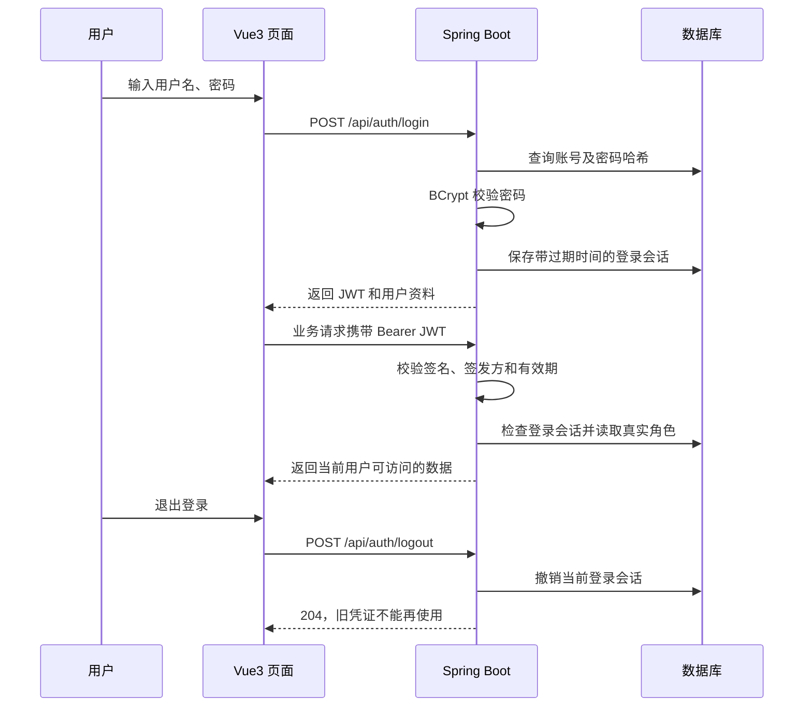

# 功能 01：注册、登录与角色权限

本文介绍最初的登录模块。当前三个角色的完整第一版业务功能见 [功能导览](02-platform-features.md)。

## 怎么体验

在 VS Code 中打开两个 PowerShell 终端，从项目根目录分别执行：

```powershell
./scripts/dev.cmd run
```

```powershell
./scripts/frontend.cmd dev
```

打开 http://127.0.0.1:5173 。登录页面的三个演示按钮会填入账号，然后点击“登录并进入”。

| 身份 | 用户名 | 开发环境密码 |
| --- | --- | --- |
| 主人 | owner | PetDemo123! |
| 喂养员 | sitter | PetDemo123! |
| 管理员 | admin | PetDemo123! |

演示账号仅在 `dev` / `test` 环境初始化。可以注册新的主人或喂养员，不能自行注册管理员。当前是账号密码登录，没有手机号验证码、忘记密码或喂养员资质审核功能。

工作台显示真实账号信息。主人读取自己的宠物列表，喂养员读取平台公开时段，管理员读取用户列表；其他业务页面后续逐项完善。新注册的喂养员目前直接拥有演示业务权限，后续审核模块完成时应增加“审核通过才可发布时段”的限制。

## 看哪些代码

| 文件 | 重点 |
| --- | --- |
| frontend/src/views/AuthPage.vue | 注册、登录表单，角色选择、错误反馈、提交按钮 |
| frontend/src/stores/auth.ts | 调用登录接口、保存凭证、刷新核实身份、退出 |
| frontend/src/router.ts | 未登录时返回登录页 |
| frontend/src/views/WorkspacePage.vue | 根据后端返回的角色显示工作台 |
| src/main/java/com/petsitting/auth/AuthController.java | 注册、登录、当前用户、退出接口及参数校验 |
| src/main/java/com/petsitting/auth/AuthService.java | BCrypt 密码校验、签发 JWT、保存 / 撤销登录会话 |
| src/main/java/com/petsitting/auth/SecurityConfig.java | 验证 JWT 签名、有效期、会话与管理员权限 |
| src/main/java/com/petsitting/BookingController.java | 从已认证身份获取用户 ID，替换旧演示请求头 |
| src/test/java/com/petsitting/AuthIntegrationTest.java | 使用真实签名凭证测试安全边界 |
| frontend/tests/auth.spec.ts | 在 Chrome 中实际操作表单、登录、刷新与退出 |

## 登录流程



用户名统一转小写，数据库唯一约束阻止重复注册。账户与凭证在同一事务创建，重复用户名不会留下孤立账户。密码限制为 8–64 个字符且最多 72 个 UTF-8 字节，不允许 BCrypt 静默截断。

JWT 两小时过期。角色从数据库读取，客户端不能修改角色。登录会话校验支持退出立即失效；退出一个会话不影响另一个会话。前端路由只改善交互，后端仍独立检查权限。`X-User-Id` 不再用于确定身份。

JWT 密钥默认在启动时随机生成，重启后须重新登录。需要跨重启保持有效时，通过环境变量 `APP_JWT_SECRET_BASE64` 传入至少 32 字节随机密钥的 Base64 编码，不要提交密钥。浏览器凭证存在当前标签页的 sessionStorage 中；目前没有刷新令牌。线上部署前仍需加入 HTTPS、登录限速和生产配置。

## 验证

本次结果：18 项后端测试、6 项 Chrome 浏览器测试全部通过，Vue 类型检查与生产构建通过；使用 JWT 的真实 HTTP 预约、幂等重试、接单、取消与时段释放流程通过。

```powershell
./scripts/dev.cmd test
./scripts/frontend.cmd build
# 启动后端后，浏览器测试会自动启动并关闭前端测试服务；需安装 Google Chrome。
./scripts/frontend.cmd test
./scripts/smoke.cmd
```

浏览器截图输出到 `docs/screenshots/`。浏览器测试会在本地开发库中创建测试账号；后端自动化测试使用内存数据库，不改动开发库。

实现依据：[Spring Security JWT 文档](https://docs.spring.io/spring-security/reference/servlet/oauth2/resource-server/jwt.html)、[Vue 快速开始](https://vuejs.org/guide/quick-start.html)、[Playwright Chrome 支持](https://playwright.dev/docs/browsers#google-chrome--microsoft-edge)。
