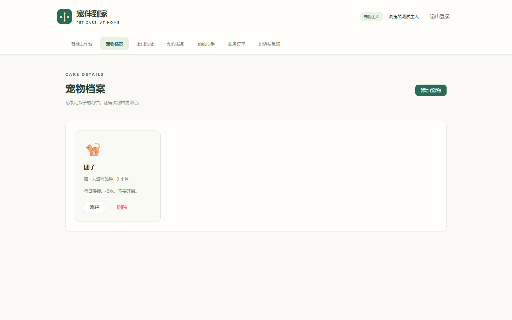
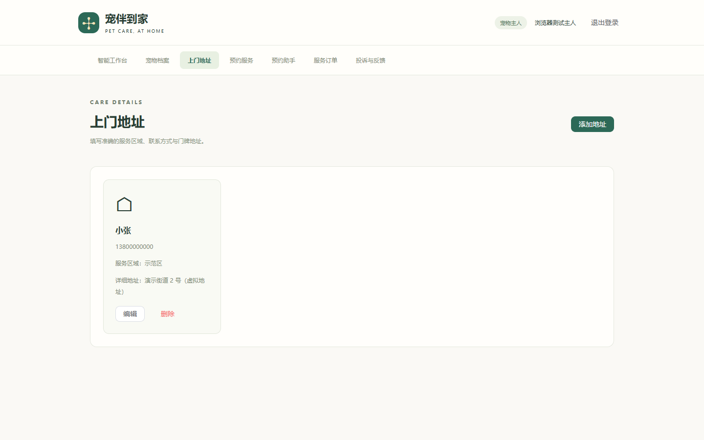
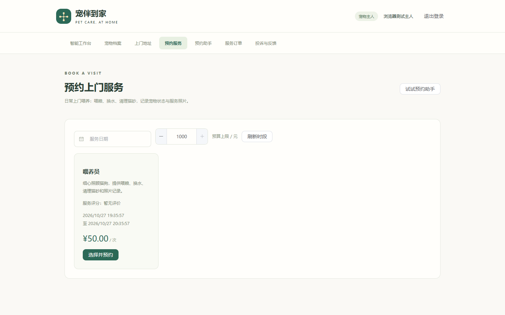
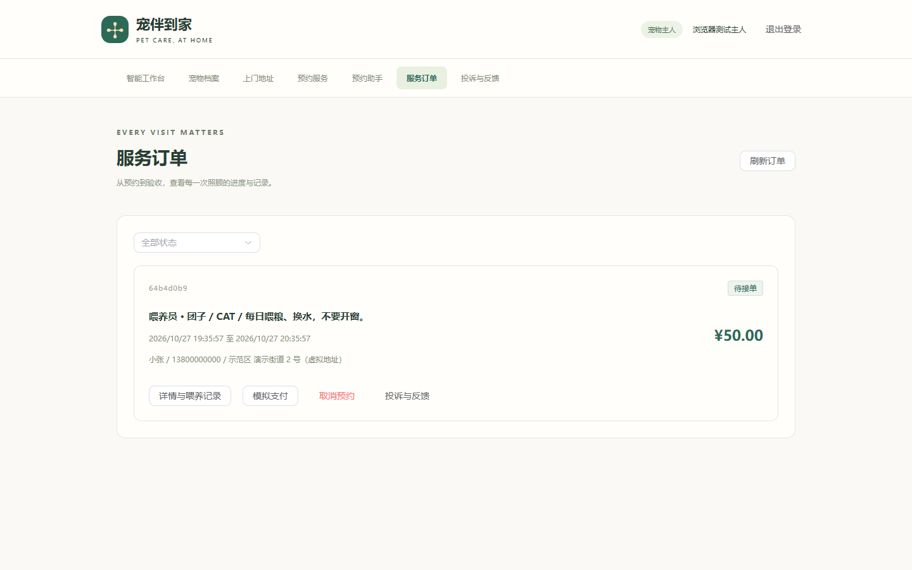
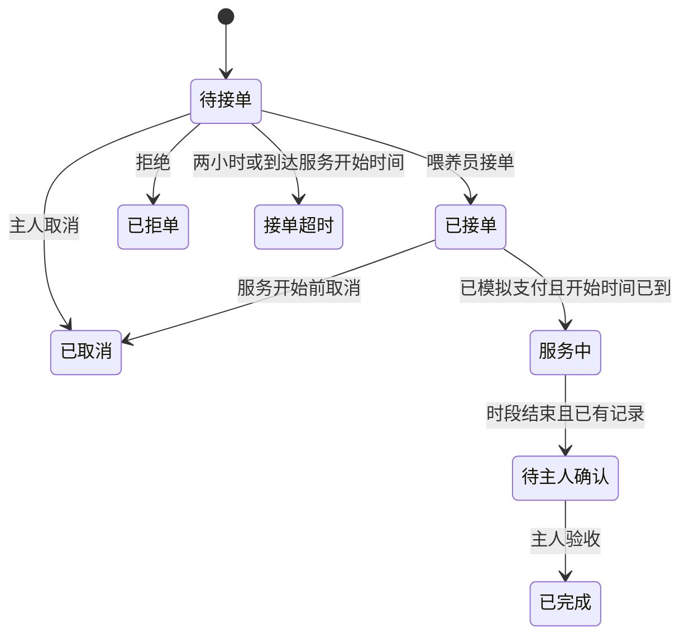
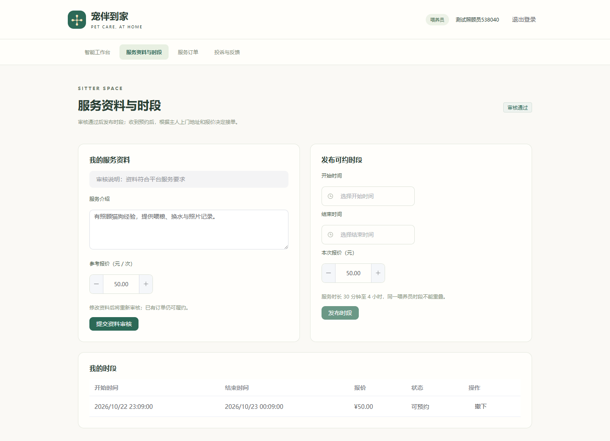
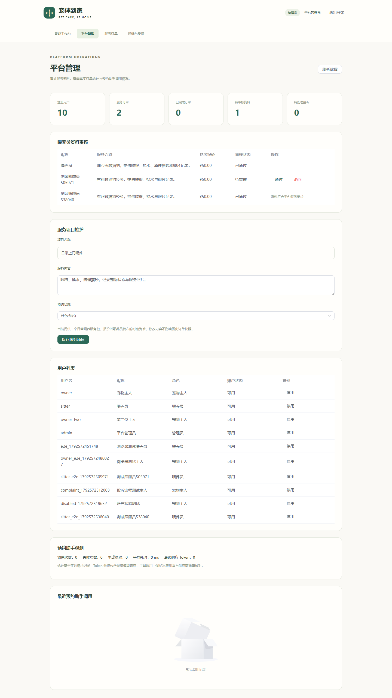
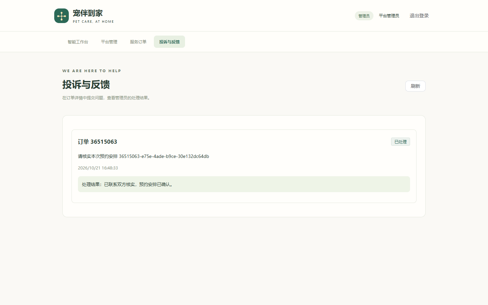
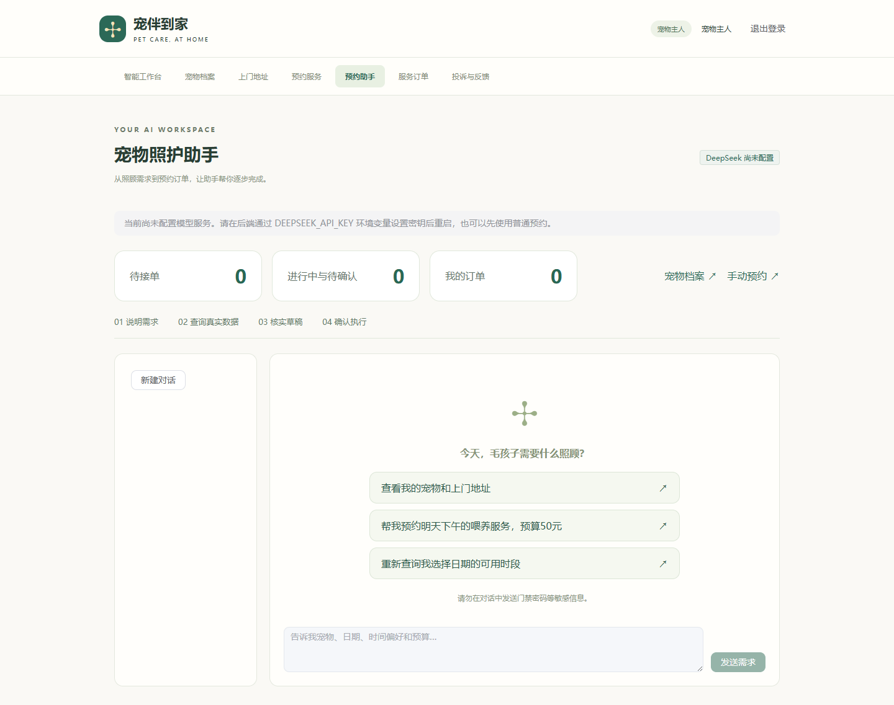

# 功能导览与代码位置

所有功能都在当前项目目录；请重启后端并刷新前端后查看顶部导航。第一版支持三个角色，支付为模拟，DeepSeek 需要自己的密钥才能真实调用。

## 主人端：宠物与地址

点击“宠物档案”，可以添加、编辑和删除宠物，填写类型、品种、月龄和照顾事项。点击“上门地址”，维护联系人、电话、服务区域与门牌。

页面：[OwnerDataPage.vue](../frontend/src/views/OwnerDataPage.vue)。后端：[DirectoryController.java](../src/main/java/com/petsitting/directory/DirectoryController.java)、[DirectoryService.java](../src/main/java/com/petsitting/directory/DirectoryService.java)、[DirectoryMapper.java](../src/main/java/com/petsitting/directory/DirectoryMapper.java)。删除资料保留历史订单快照；他人不能修改你的资料。

## 主人端：预约与订单

点击“预约服务”筛选日期与预算，选择具体时段，再选择自己的宠物和地址。不要求地址区域与喂养员一致，喂养员查看上门地址和报价后决定是否接单；确认创建后进入订单页。

订单页可以模拟支付、开始前取消、看喂养记录、验收、评价和投诉。取消已支付订单后显示模拟退款。时间和状态由后端校验，点击按钮不能跳过规则。

页面：[BookingPage.vue](../frontend/src/views/BookingPage.vue)、[OrdersPage.vue](../frontend/src/views/OrdersPage.vue)。后端：[BookingService.java](../src/main/java/com/petsitting/BookingService.java)。

## 喂养员端

点击“服务资料与时段”，填写介绍和参考报价并提交。管理员审核通过后才能发布时段；修改资料会重新进入审核，已有订单仍可履约。

订单页接单或拒单。已支付订单到开始时间后可以“开始服务”，打开详情填写喂养记录、选择照片并保存；时段结束后提交完成，由主人验收。照片是私有资源，不会通过公开地址泄露。

页面：[SitterPage.vue](../frontend/src/views/SitterPage.vue)、[OrdersPage.vue](../frontend/src/views/OrdersPage.vue)、[PrivatePhoto.vue](../frontend/src/components/PrivatePhoto.vue)。照片接口：[MediaController.java](../src/main/java/com/petsitting/MediaController.java)。

## 管理员端

点击“平台管理”查看真实统计、审核资料、维护日常服务包、停用/启用用户和查看助手调用观测。“服务订单”查看所有订单，“投诉与反馈”填写处理结果；报告人可以看到结果。

页面：[AdminPage.vue](../frontend/src/views/AdminPage.vue)、[ComplaintsPage.vue](../frontend/src/views/ComplaintsPage.vue)。审核：[DirectoryService.java](../src/main/java/com/petsitting/directory/DirectoryService.java)。账号状态：[AuthService.java](../src/main/java/com/petsitting/auth/AuthService.java)。

## 预约助手

设置 DeepSeek 环境变量并重启后端后，可新建对话并输入宠物、日期、时间偏好、区域和预算。助手通过工具查询并补问，生成草稿后等待主人点击确认；不能直接下单。

页面：[AgentPage.vue](../frontend/src/views/AgentPage.vue)。工具：[AgentTools.java](../src/main/java/com/petsitting/agent/AgentTools.java)。确认事务：[DraftService.java](../src/main/java/com/petsitting/agent/DraftService.java)。模型：[DeepSeekAgentModel.java](../src/main/java/com/petsitting/agent/DeepSeekAgentModel.java)。模型错误、重复确认、草稿过期、报价变化和时段被抢占都有后端保护。

## 验证证据

- 60项后端测试通过，包含17项真实MySQL业务测试和16个主人抢一个时段的验证。
- 12项Chrome测试通过：注册、三个角色登录、刷新/退出、宠物地址、预约支付取消、审核发布时段、投诉处理、账户停用与手机布局。
- Spring AI工具协议在本地模拟DeepSeek服务验证；真实DeepSeek固定评测9/9通过，包含完整预约闭环、地址更新、重复确认和抢占后的拒绝；模型评测结果单独记录。
- 生产构建在Chrome中验证了登录、管理与订单页；生产MySQL配置验证管理员初始化和权限。

对应测试：[PlatformFeaturesTest.java](../src/test/java/com/petsitting/PlatformFeaturesTest.java)、[MySqlFeaturesTest.java](../src/test/java/com/petsitting/MySqlFeaturesTest.java)、[DeepSeekProtocolTest.java](../src/test/java/com/petsitting/DeepSeekProtocolTest.java)、[business.spec.ts](../frontend/tests/business.spec.ts)。

最新 Agent 演示与追踪见 [预约 Agent 演示与评测](03-agent-demo-evaluation.md)，代码职责见 [后端架构](04-backend-architecture.md)。
