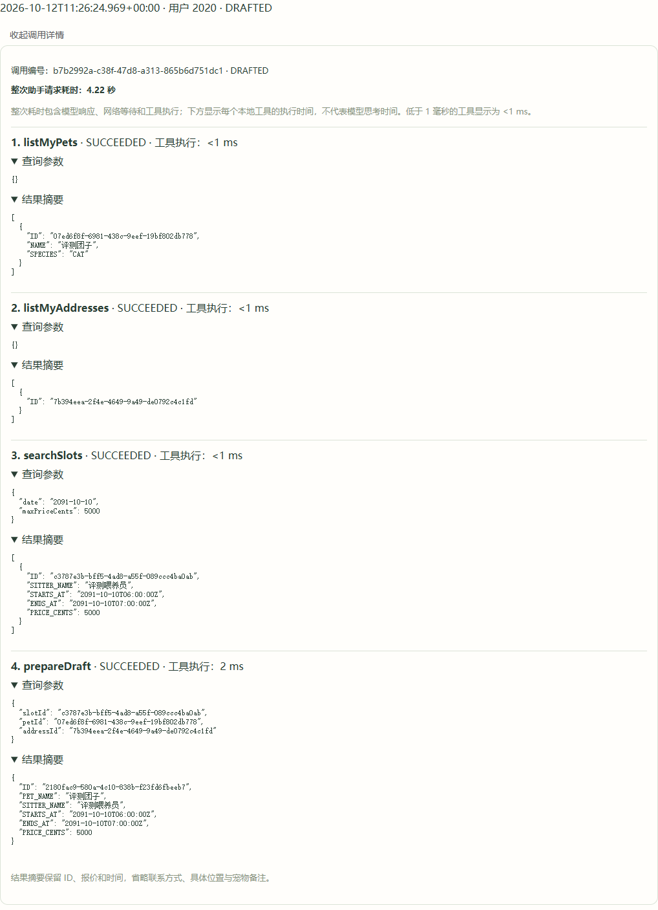
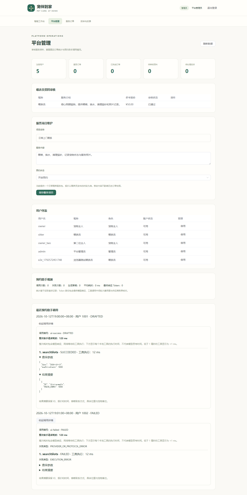

# 预约 Agent：真实演示、评测和调用追踪

项目提供三种不同的验证：Java 集成测试验证工具协议和业务保护；浏览器测试验证界面；真实 DeepSeek 评测验证模型如何选择工具及完成任务。报告必须注明是哪一种，不能把协议模拟结果当成模型效果。

## 本次验证进度

2026-10-12：60项后端测试在H2和真实MySQL上通过，12项Chrome浏览器测试通过，生产构建浏览器检查通过。

首次真实DeepSeek评测执行2个用例：完整预约闭环通过；重复确认用例在生成草稿前暴露了跨轮猜测ID的问题，未进入确认阶段。原始结果保留在 [首次真实评测报告](evaluation/initial-real-run.json)，没有将失败改写为通过。

已修复：跨轮补充真实工具ID上下文，草稿必须使用本轮重新读取的宠物、地址和时段ID。修复后的工具协议和业务回归通过。最终版真实DeepSeek评测9/9通过，共15条模型消息、45次实际工具执行，预期工具覆盖率为100%；所有用例清理成功。该比例仅代表本轮固定用例，不代表生产成功率。

查看 [最终真实评测摘要](evaluation/latest-real-evaluation.md) 与 [完整逐轮证据](evaluation/latest-real-evaluation.json)。重复确认用例耗时包含IP限速后的等待与重试，不能把整项耗时当作单次模型推理时间。



上图来自本轮真实模型调用的管理员页面，包含宠物、地址、时段查询与草稿生成；使用虚拟评测数据。时间参数带Z表示UTC，06:00对应北京时间14:00。



上图是浏览器界面测试固定数据，展示成功与失败追踪的显示效果，不是真实模型成功率证据。

## 启动真实模型

在项目根目录的 PowerShell 终端执行：

```powershell
.\scripts\start-agent.cmd
```

按提示输入自己的 DeepSeek API Key。输入隐藏，密钥只传给本次后端进程，不保存到代码、文件或数据库。关闭进程后需要重新配置。若旧后端已启动，先在原终端按 Ctrl+C 并等待退出。

另一个终端启动前端：

```powershell
.\scripts\frontend.cmd dev
```

打开 http://127.0.0.1:5173/。页面“已连接配置”表示读取到了密钥，不代表已验证供应商调用成功。

## 手工复现完整预约闭环

1. 喂养员填写服务介绍和参考报价；管理员审核通过后，发布未来日期 14:00–15:00 的时段，报价50元。喂养员没有服务区域限制。
2. 主人维护一只宠物和自己的完整上门地址。位置所在区域和详细地址均保留，喂养员接单前能够查看订单地址。
3. 新建预约助手对话，发送“我想预约上门喂宠物，还没确定日期和预算，请先问我缺少的信息”。观察补问，确认没有草稿或订单。
4. 补充宠物、具体日期、地址和预算：“请读取我的宠物和地址，查询刚发布的日期下午14点、预算50元的时段，先查询，不生成草稿。”
5. 展开“查看调用详情”，应看到 `listMyPets`、`listMyAddresses`、`searchSlots` 的实际执行记录。核对查询日期和预算5000分，以及返回的时段ID。
6. 回复“我选择14:00–15:00的50元时段，为这只宠物使用我的地址生成预约草稿，等待我点击确认”。模型需要在本轮重新查询时段，然后调用 `prepareDraft`。
7. 出现草稿卡片后，核对宠物、地址、北京时间和价格。此时仍没有订单，草稿不占用时段，有效期15分钟。
8. 点击“确认草稿并创建预约”，进入订单列表，应出现一张待接单订单。喂养员依据地址和报价接单或拒单。

取消或拒单会释放时段。重复确认同一草稿返回同一订单；若草稿后时段已被占用，确认必须失败；地址、宠物、价格或服务内容变化也会要求重新生成草稿。

## 运行真实模型评测

需要 Python 3，无第三方 Python 依赖。后端必须已启用 DeepSeek 和 V8 追踪迁移。评测脚本通过平台 API 使用模型，脚本不读取模型密钥。

```powershell
python .\scripts\evaluate_agent.py
```

可以先只跑闭环：

```powershell
python .\scripts\evaluate_agent.py --cases draft_confirmation,duplicate_confirmation
```

用例定义在 [booking-agent-cases.json](../evals/booking-agent-cases.json)。覆盖：缺失信息、无时段、预算不足、完整草稿确认、地址更新、空结果后发布并刷新、重复确认、确认前被占用、要求绕过确认直接付款。

每个用例创建独立虚拟主人、喂养员、宠物和地址，使用独立远期日期以避免与日常演示混淆。结束时取消自己的测试预约、撤下自己的时段并停用测试账户；历史订单与追踪保留供核对。不会改写已有用户资料。清理失败会进入报告并使该用例失败。

JSON 和 Markdown 报告输出到 `target/agent-evaluation/`，包含逐轮输入、模型回复、草稿、真实工具执行记录、每条断言和耗时。报告使用虚拟数据，不包含登录令牌或 API Key。

评测指标：

| 指标 | 判断依据 |
|---|---|
| 任务通过率 | 工具执行、草稿字段、订单数、确认结果和清理均符合预期 |
| 预期工具覆盖率 | 数据库追踪中实际成功执行的工具覆盖用例要求 |
| 单用例耗时 | 从准备虚拟数据到用例清理完成，包含模型与HTTP时间 |

这不是人工主观打分，也不是让另一个模型给回复评分。补问检查使用日期/预算关键词，其余关键断言基于工具与订单数据。一次9个用例的结果仅代表该模型、提示词和数据上的一次运行；不代表生产成功率。运行失败需记录原因，不能修改报告把失败改成通过。

## 调用追踪

主人在预约助手页面查看当前会话最近一次调用；管理员在平台管理页查看最近调用，包含失败请求。接口：

```text
GET /api/agent/sessions/{id}/runs
GET /api/agent/runs/{id}
GET /api/admin/agent-runs
```

每次模型请求生成一个 runId；实际执行的每个业务工具记录顺序、工具名、参数、结果摘要、状态、失败类型及耗时。工具失败被 Spring AI 转成反馈后，模型可能继续补问，因此工具失败不一定意味着整次模型请求失败。追踪不包含模型内部思维链。

结果摘要仅保留宠物ID/名称/类型、时段ID/报价/时间、草稿ID；省略联系人、电话、具体位置和宠物备注。主人仅能查看自己的调用；管理员可查看所有调用，其他用户不能访问。

Token 统计当前仅取最终模型响应，工具调用中间轮次的供应商成本需要核对 DeepSeek 账单。

## 常见排查

- 查询为空：展开参数，核对北京时间日期和预算单位；展开结果，确认是否返回空数组。地址不用于筛选喂养员。
- 草稿缺失：看是否执行了 `prepareDraft`，以及是否失败；草稿只能使用本轮 `searchSlots` 返回的时段。
- 重新查询后仍为空：看本轮是否真的执行了 `searchSlots`，不能只依据助手文字声称“重新查了”。
- 密钥未配置：使用 `start-agent.cmd` 在本地重新配置并启动。
- 供应商或协议失败：整次请求记录 `PROVIDER_OR_PROTOCOL_ERROR`；不把供应商原始异常、请求头或密钥返回给客户端。
