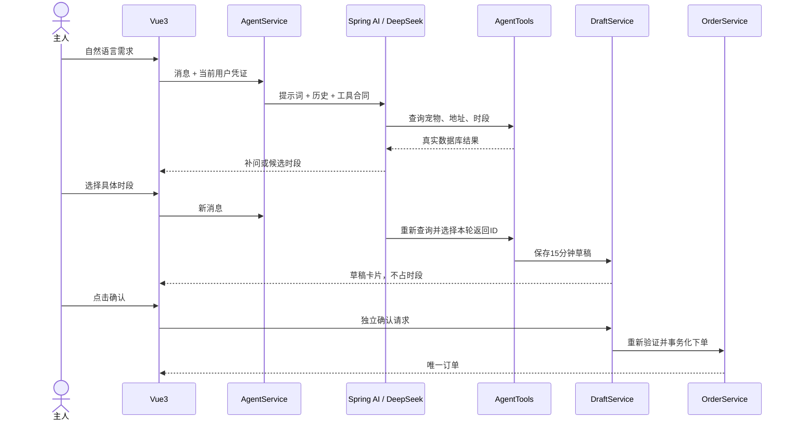

# 后端架构与事务边界

系统是前后端分离的单体：Vue3 → Spring Security → Controller → 领域 Service → MyBatis/JdbcTemplate → H2或MySQL。数据库结构由 Flyway 增量迁移。模型调用通过 Spring AI 的 DeepSeek 适配器执行。

## 模块职责

| 模块 | 主要职责 | 事务边界 |
|---|---|---|
| auth | 认证、密码、JWT会话、账户启停 | 注册、撤销会话、启停账户 |
| directory | 宠物、地址、喂养员资料审核 | 保存/删除资料、审核 |
| booking/SlotService | 发布、查询、撤下时段 | 发布时锁喂养员防重叠；撤下锁时段 |
| booking/OrderService | 创建、查询、状态流转、超时取消 | 创建/支付/接单/取消/完成/验收/超时 |
| booking/FulfillmentService | 履约记录和照片归属验证 | 添加记录 |
| booking/FeedbackService | 评价与投诉 | 新增评价、投诉、处理投诉 |
| booking/AdminStatsService | 平台统计 | 只读聚合 |
| booking/BookingRepository | JDBC查询结果转换、基础查询 | 加入调用方事务 |
| agent/AgentService | 会话、额度、模型调用协调 | 不用长事务包住模型网络请求 |
| agent/AgentTools | 受限的带类型工具合同 | 写草稿交给DraftService |
| agent/DraftService | 生成草稿、用户确认 | 保存草稿；确认与下单共用事务 |
| agent/AgentTraceService | 请求与逐工具追踪、访问权限 | 追踪独立保存，失败仍可诊断 |

BookingService 现在是兼容现有 REST 接口的薄适配层，没有业务SQL或独立事务。它委托给被 Spring 代理的领域服务，因此拆分不会绕过 `@Transactional`。领域服务不反向依赖该适配层的实例；现有静态时间转换后续可继续迁移到公共类型工具。

订单状态和动作使用 `OrderState`、`OrderAction` 枚举；Agent 工具使用明确的 PetOption、AddressOption、SlotOption、DraftSummary、ToolTrace records，避免模型接口依赖数据库的全部列。旧 REST 响应及部分数据库行仍保留 Map，逐步迁移，不声称全项目都已完成类型化。

## 下单与并发

下单在一个事务内依次锁主人账户、宠物/地址、喂养员账户、时段，检查幂等键、归属、账户状态、审核、项目开放和时段可用性，再写订单和占用时段。当前账户级锁比较保守，适合小规模单体；高吞吐量下需要进一步缩小锁粒度并重新做并发测试。

相同主人与相同幂等键重试：参数一致返回原订单；参数不一致返回冲突。订单保存地址、宠物、服务和价格快照，后续资料变化不改写历史订单。

取消、拒单和超时：锁时段及订单，确认原状态允许变化后，在同一事务里更新订单、释放时段并做模拟退款。已经终止的订单重试不会再次释放后来预约的时段。

## Agent 与用户确认

模型只能使用当前用户的受限工具，不能传 actor、不能直接创建订单或付款。草稿确认检查归属、有效期、宠物/地址/服务内容/价格变化和时段可用性；重复确认返回原订单。

同一对话的忙碌租约避免同时处理两条消息；每日额度在短事务内预留；模型请求有连接/读取超时和工具轮次上限。模型错误时不创建订单，追踪记录保留。对话历史当前仅保存用户和助手最终文字，逐工具脱敏结果补充到下一轮系统上下文，提供真实历史ID，但不作为完整模型工具消息历史重放；生成草稿必须重新查询当前宠物、地址与时段。

## 验证边界

- Java：H2和真实MySQL的订单并发、幂等、状态、归属、草稿、追踪权限与模拟供应商协议。
- Playwright：注册、登录、三角色业务页面及追踪组件固定数据的显示。
- 真实模型评测：独立脚本使用已经配置密钥的运行后端，报告与协议模拟测试区分。

真实支付、地图测距、对象存储、多实例限流和公网部署仍未实现或验证；当前支付与退款明确为模拟。
